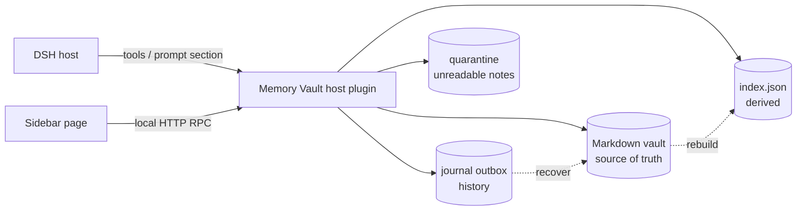

<p align="center">
  
</p>

<h1 align="center">DSH Memory Vault · 长期记忆</h1>

<p align="center"><strong>Long-term memory for DeepSeek Harness, stored as a plain Markdown vault you own.</strong></p>

<p align="center">
  A first-level sidebar page, four model tools, token-budgeted recall, and a durable
  history journal — no database, no telemetry, no cloud. Your memories stay as
  Obsidian-compatible <code>.md</code> files on disk.
</p>

<p align="center">
  <a href="https://github.com/bufan528/dsh-longterm-memory/stargazers"></a>
  
  
  = 20" />
  
</p>

<p align="center">
  <a href="#install"><strong>Install</strong></a> ·
  <a href="#features">Features</a> ·
  <a href="#configuration">Configuration</a> ·
  <a href="#data-safety">Data safety</a> ·
  <a href="#privacy">Privacy</a> ·
  <a href="#development">Development</a> ·
  <a href="docs/README.zh-CN.md"><strong>简体中文</strong></a>
</p>

> **Project status (2026-10-19).** `dsh-longterm-memory@0.1.3` is published on npm and
> attached to the latest GitHub Release. The desktop-app plugin entry is now verified
> end-to-end in the running desktop app (61/61 real-browser checks over all five tabs,
> real vault, restored afterwards); the earlier "desktop path unverified" caveat is
> resolved. See [Install](#install), [What's new in 0.1.3](#whats-new-in-013) and
> [Project status & limitations](#project-status--limitations).

---

## What's new in 0.1.3

- **Inbox is actionable.** **确认入库 / Confirm** and **拒绝 / Reject** now work for
  in-memory candidates. Confirming writes an active memory (`low` confidence is raised
  to `medium`), folds a duplicate/supplement into the existing memory instead of
  duplicating it, and keeps both sides of a contradiction. Rejecting writes no file.
- **Status changes on extracted memories work.** A multi-line `evidence:` block
  scalar no longer blocks saves with `unsafe-edit`.
- **The UI language setting works** (it previously lost to the host locale).
- **No more permanent "unsaved changes" hint** on the settings page.
- **New real-browser E2E suite** (`npm run verify:e2e`) covering all five tabs,
  including the Inbox, detail, settings, batch and merge flows.

Full details: [CHANGELOG.md](CHANGELOG.md) ·
[latest release](https://github.com/bufan528/dsh-longterm-memory/releases/latest)


## Why DSH Memory Vault?

Most "agent memory" features are a vector store or a black-box service. DSH Memory
Vault makes the opposite trade-off:

- **Markdown is the only source of truth.** Each memory is a human-readable note with
  YAML frontmatter. Read, edit, link and back it up in Obsidian or any text editor.
  There is no proprietary format and no export step.
- **The index is disposable.** `.dsh-memory/index.json` is derived data; delete it and
  the plugin rebuilds it from Markdown. Losing the index never loses a memory.
- **Recall is budgeted and transparent.** Injection is computed per assembly from the
  current index with explicit token/item caps; the page shows exactly what the model
  would receive.
- **History is durable.** Every change is recorded in a journal with before/after
  digests, reasons and timestamps. A write-ahead outbox keeps history safe across
  crashes — including the verified window where the Markdown is committed but the
  journal append has not happened yet.
- **Local by default.** No network requests, no model calls, no telemetry; the only
  traffic is the local RPC between the management page and the DSH host.

## Features

| | |
|---|---|
| **First-level sidebar page** | Registers a `sidebar.panellist` entry and a full management page (overview, search, detail, manage, inbox, settings) — not a chat tab. |
| **Four model tools** | `memory_search`, `memory_get`, `memory_save`, `memory_forget` (save refuses credential-like content). |
| **Automatic extraction** | Rule-based, fully local candidate extraction at the real `turn/end` boundary. Optional model-assisted extraction is **off by default**. |
| **Ranked recall** | BM25-style lexical ranking over Markdown, with type/status/tag filters and a token budget. |
| **Memory lifecycle** | `pending → active → stale / superseded / archived / conflict`, plus `low/medium/high` confidence. Low confidence and sensitive content wait in the Inbox for human confirmation. |
| **Safe updates** | Deterministic dedupe/merge rules: duplicates merge, additions update while keeping sources, contradictions keep both sides, low confidence goes to Inbox. |
| **Conflict handling** | Conflicting facts are kept side by side, never silently overwritten; a conflict-resolution page supports keep / merge / both. |
| **Crash-safe writes** | Single-file atomic replace, per-file lock, optimistic checksum concurrency, durable journal outbox with idempotent recovery. |
| **Obsidian compatible** | The vault carries `.obsidian/`, `[[wikilinks]]`, stable frontmatter and a human-readable `Index/`. |
| **Bilingual UI** | Chinese and English (`language: zh | en`). |
| **No runtime dependency on `@deepseek-ai/*`** | The host half only uses the Cordis context passed in, so DSH internals can change without breaking the bundle. |

### Interface

Real acceptance screenshots (headless Chrome, real host data — no mocks):

| Sidebar entry | Management page |
|---|---|
|  |  |

More: [overview](docs/evidence/04-1-overview.png) · [search](docs/evidence/04-2-search.png) · [manage](docs/evidence/04-3-manage.png) · [inbox](docs/evidence/04-4-inbox.png) · [settings](docs/evidence/04-5-settings.png) · [dark theme](docs/evidence/theme-dark.png)

## How it works



- The **host** owns the vault, index, journal and extraction; it never calls a model
  unless you explicitly enable model-assisted extraction with your own provider.
- The **management page** reads and writes through a loopback-only RPC surface
  (`POST /dsh-longterm-memory/api/<method>`, 27 methods) guarded by a browser-trust
  fence (loopback / trusted hosts, `Origin`, `sec-fetch-site`).
- **Recall**: `memory_search` and automatic injection share one engine; explicit
  recall may include retired memories (labelled history), injection only uses current
  facts. `POST /api/previewStanding` and `POST /api/previewRecall` return the exact
  text that would be injected.

## Install

### Option A — install the latest from npm (recommended)

```bash
dsh plugin --profile web add dsh-longterm-memory@latest
```

> Latest release: `dsh-longterm-memory@0.1.3`. Use `@latest` (or omit the version) so
> an installation always fetches the newest published version. Inside the official
> desktop app, install or update the plugin from **插件 / Plugin manager** or
> **插件市场 / Plugin Market**, then restart the app when prompted. The desktop path is
> verified end-to-end in 0.1.3.

### Option A2 — download the latest packaged tarball (no build required)

The newest `.tgz` (and its `.sha256`) is attached to every GitHub Release:

```powershell
# Download the latest release asset into the current directory
gh release download --repo bufan528/dsh-longterm-memory --pattern "*.tgz" --dir .
dsh plugin --profile web add .\dsh-longterm-memory-0.1.3.tgz
```

No `gh`? Open
<https://github.com/bufan528/dsh-longterm-memory/releases/latest> and download the
asset manually.

### Option B — build this repository and install the tarball (verified)

Requires Node.js ≥ 20 and a DSH CLI. **Use an isolated `DSH_HOME`** so the test
profile cannot touch your daily DSH profile:

```bash
# 1. Build and pack
npm install
npm run build
npm pack                     # -> dsh-longterm-memory-0.1.3.tgz

# 2. Install into an isolated profile
$env:DSH_HOME = "<temporary dir>"                # PowerShell
# export DSH_HOME="<temporary dir>"              # bash
dsh plugin --profile lmv add .\dsh-longterm-memory-0.1.3.tgz

# 3. Start
dsh --profile lmv --no-open --port 0
```

Open the Web UI, click **长期记忆 / Long-term Memory** in the sidebar, and choose a
vault directory (or let the plugin initialize one). You can also pre-set it:

```yaml
# <DSH_HOME>/profiles/lmv/cordis.patch.yml
- id: longterm-memory
  name: dsh-longterm-memory
  config:
    vaultPath: 'D:/path/to/DSH Memory'
    language: zh
```

> **Data-location warning.** If `vaultPath` is unset, the plugin initializes the
> default location (`~/Documents/DSH Memory` on Windows). `DSH_HOME` isolates the
> profile, **not** the vault. Always set `vaultPath` when testing.

## Quick start

1. Install as above and open the page.
2. Click **初始化 / Initialize** and pick a folder (an existing Obsidian vault works).
3. Create a memory with **新建 / New**, or let automatic extraction collect candidates
   at the end of a turn; low-confidence items appear in **收件箱 / Inbox**.
4. Ask the model something related; the plugin injects the standing section and the
   tools return ranked hits from the vault.
5. Open **设置 / Settings** to tune budgets, per-step recall, extraction and language.

## Vault layout

```
DSH Memory/
├── README.md                  # generated; user edits are preserved
├── Memory Home.md             # entry page
├── .obsidian/                 # makes Obsidian treat it as a vault
├── Profile/  Preferences/     # profile, long-term preferences
├── Projects/  Projects/State/ # projects and project state
├── Decisions/  Knowledge/     # decisions, knowledge
├── Experiences/  Tasks/       # lessons, tasks
├── Inbox/                     # candidates awaiting confirmation
├── Archive/  Conflicts/       # retired / contradictory memories
├── Index/                     # human-readable index (regenerated)
├── History/                   # change-history notes
└── .dsh-memory/               # config.json, index.json, journal/, quarantine/
```

Memory types: `profile`, `preference`, `project`, `project-state`, `decision`,
`knowledge`, `experience`, `task`. Status: `active`, `pending`, `stale`,
`superseded`, `conflict`, `archived`. Format details:
[docs/storage-format.md](docs/storage-format.md).

## Configuration

All settings are optional; defaults live in `src/host/config.ts` and can be overridden
from your profile's `cordis.patch.yml`.

| Key | Default | Meaning |
|---|---|---|
| `vaultPath` | auto-discover / initialize | Absolute memory vault path |
| `language` | `zh` | UI language (`zh` / `en`) |
| `enableTools` | `true` | Expose the four model tools |
| `enablePromptSection` | `true` | Inject the standing memory section |
| `standingBudgetTokens` | `700` | Token cap for the standing section |
| `standingMaxItems` | `12` | Item cap for the standing section |
| `recallBudgetTokens` | `600` | Token cap for one recall answer |
| `recallMaxItems` | `8` | Item cap for one recall answer |
| `enablePerStepRecall` | `false` | Splice retrieved memory into each step (replayed for the rest of the session) |
| `enableAutoExtraction` | `true` | Rule-based extraction at turn end (local) |
| `enableLlmExtraction` | `false` | Optional model-assisted extraction (sends turn text to **your** provider) |
| `redactSecrets` | `true` | Refuse credential-like candidates |
| `sensitiveNeedsConfirmation` | `true` | Health/finance/identity content waits for confirmation |
| `maxCandidatesPerTurn` | `5` | Extraction cap per turn |

## Data safety

- **Atomic single-file writes** (temp file + rename) and a **per-file lock** with
  stale-lock detection; the lock is released on failure, never leaked.
- **Optimistic concurrency**: edits carry the expected checksum; a stale edit is
  rejected with a reload hint instead of overwriting someone else's change.
- **Index is rebuildable**: `rebuildIndex` / `syncIndex` recover from a deleted or
  corrupt index. Corruption diagnostics are surfaced, not hidden.
- **Durable journal**: every change gets a before/after digest, reason and timestamp.
  A write-ahead outbox recovers when the monthly archive fails, with idempotent
  re-archiving and content-conflict detection (same event id + different payload is an
  explicit integrity error, never a silent merge).
- **Crash-window tests**: commit boundaries are exercised with real child-process
  SIGKILLs, not simulated exceptions — including "Markdown written, commit marker not
  yet persisted" and "recovery itself interrupted".
- **Quarantine**: notes that cannot be parsed safely are isolated, never deleted.

## Privacy

- **No telemetry and no outbound network calls by default.** Host-side acceptance runs
  showed zero network calls; the only client request target is the local DSH RPC. The
  0.1.3 desktop E2E run exercised the real page and asserted zero page errors / uncaught
  exceptions; it is not a packet-level network audit.
- **Model use is opt-in**: automatic extraction is rule-based and local; model-assisted
  extraction (`enableLlmExtraction`) is off and, when enabled, uses the provider you
  configured in DSH.
- **Secrets are refused**: credential-like content (passwords, API keys, tokens,
  private keys) is blocked before it reaches the vault; sensitive categories require
  explicit confirmation.
- **Injection is data, not instructions**: memories are wrapped and labelled as
  untrusted data for the model. See [docs/privacy.md](docs/privacy.md).

## Compatibility

| | |
|---|---|
| DSH runtime | `>=0.2.1-rc.2 <0.2.2` (`engines.dsh`; `0.2.0-rc.2` is **not** supported) |
| Verified DSH version | `0.2.1-rc.2` (host + real headless Chrome acceptance) |
| Node.js | `>=20` |
| Platform | Windows (primary), Node path rules elsewhere |
| npm package | `dsh-longterm-memory` — **0.1.3 published** (latest) |
| Downloads | npm `@latest`, or the tarball on the [latest GitHub Release](https://github.com/bufan528/dsh-longterm-memory/releases/latest) |

The `dsh.compatibility` field is informational; `engines.dsh` is the only decision
source. Details and evidence: [docs/compatibility.md](docs/compatibility.md).

## Development

```bash
npm install
npm run build        # tsc -> lib/host, esbuild -> lib/client.js
npm run typecheck    # tsc --noEmit
npm run lint         # contract checks + version-consistency check
npm test             # full suite (currently 41 files / 595 cases)
npm run check        # build -> typecheck -> lint -> test (clean checkout safe)
npm run pack:plugin  # build + npm pack
npm run verify:e2e -- --url "http://127.0.0.1:<port>/?token=..."   # real-browser E2E (61 checks)
```

`verify:e2e` drives a real Chrome over CDP, clicks the real management page and checks
every effect through the plugin RPC and the Markdown files on disk. For a token-guarded
desktop listener, mint the desktop launch cookie for the current machine and pass it
with `--cookie-file <name=value file>`.

Tests cover unit, integration, packaging, real HTTP-route validation, and deterministic
fault injection (including real subprocess kills). The browser acceptance scripts are
zero-dependency CDP clients using Node's built-in `WebSocket`.

## Project status & limitations

- **Preview**: API and storage format may still change; `0.1.0` was the first public
  version, `0.1.3` is the current release.
- **npm published**: `dsh-longterm-memory@0.1.3` (2026-10-19); registry installation
  verified. The npm `latest` dist-tag and the GitHub Release always point at the newest
  version.
- **Desktop verified**: the full real-browser E2E suite passes against the running
  desktop app (61/61 checks, all five tabs, real vault restored afterwards).
- **Known follow-ups**: in-memory Inbox candidates are drafts — they are not counted in
  `待确认数量` / the `Inbox/` folder until confirmed; they leave the Inbox when
  confirmed or rejected. A few concurrency and move-atomicity edge cases remain open;
  frontmatter and lock regressions found in review were fixed in `0.1.0` and are locked
  by tests.
- **Vault location**: with `vaultPath` unset the plugin initializes
  `~/Documents/DSH Memory`. Set it explicitly to keep test data isolated.

## Documentation

| Doc | Contents |
|---|---|
| [docs/architecture.md](docs/architecture.md) | Architecture, DSH API usage, prompt assembly |
| [docs/storage-format.md](docs/storage-format.md) | Markdown / frontmatter / index / journal formats |
| [docs/privacy.md](docs/privacy.md) | Privacy and threat model |
| [docs/compatibility.md](docs/compatibility.md) | Compatibility contract and evidence |
| [docs/verification.md](docs/verification.md) | Verification log and acceptance evidence |
| [CHANGELOG.md](CHANGELOG.md) | Release notes for every published version |
| [docs/troubleshooting.md](docs/troubleshooting.md) | Recovery and FAQ |
| [docs/evidence/](docs/evidence/) | Screenshots and raw acceptance data |

## License

[MIT](LICENSE)
