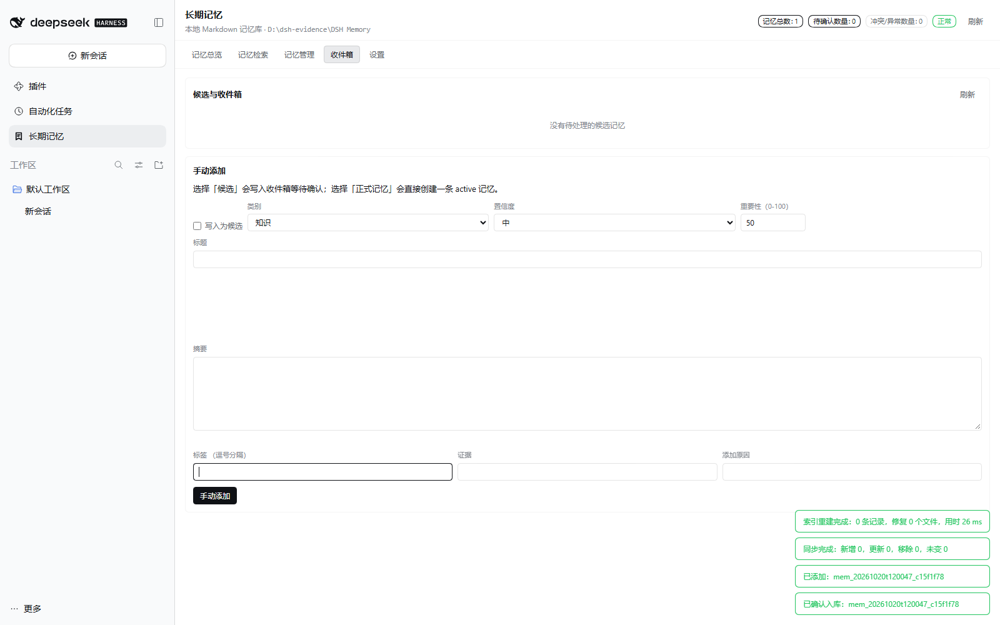
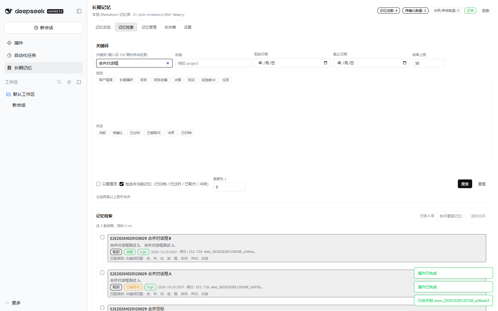
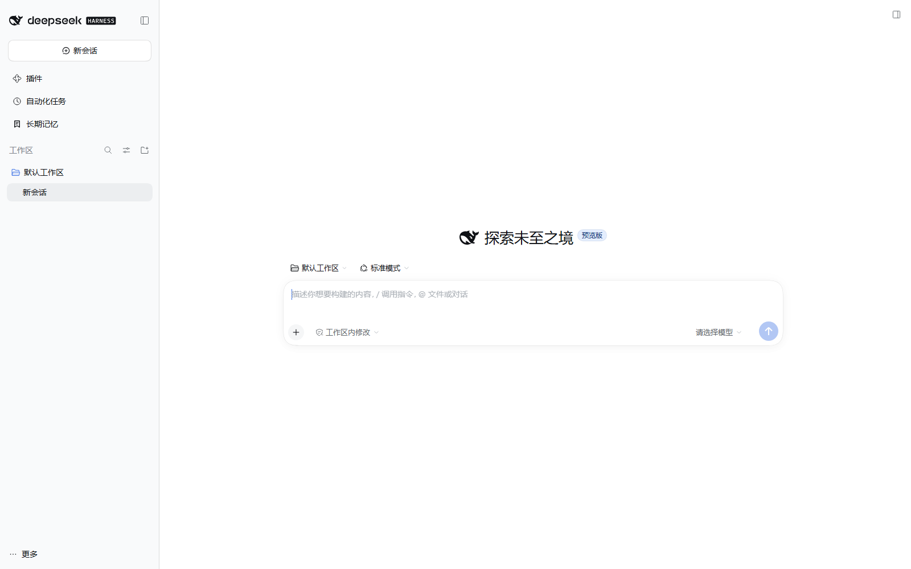
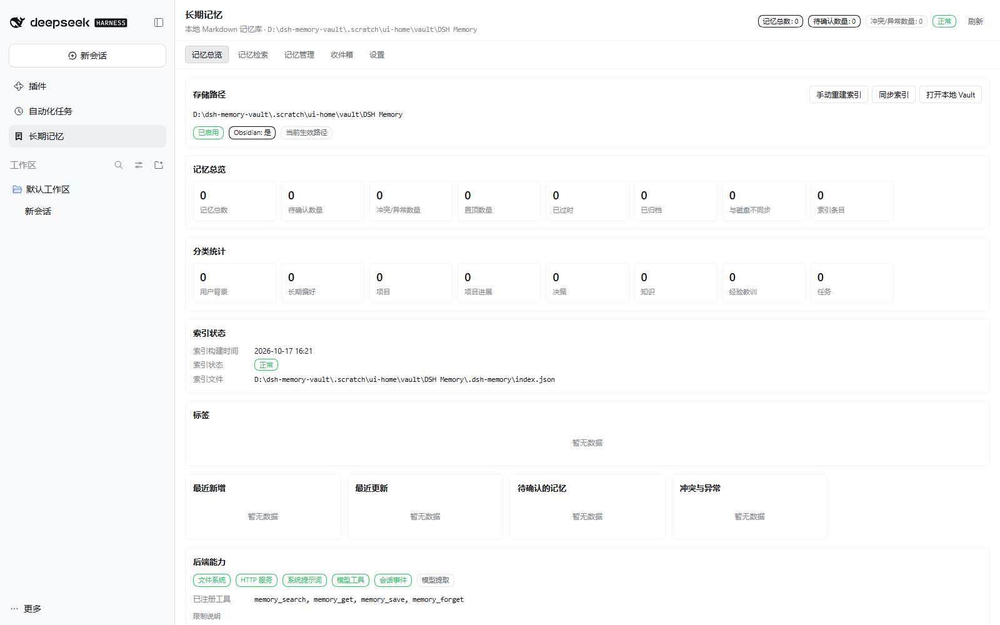
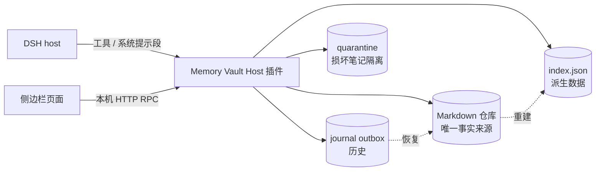

<p align="center">
  
</p>

<h1 align="center">DSH Memory Vault · 长期记忆</h1>

<p align="center"><strong>给 DeepSeek Harness 的长期记忆，存成一份完全属于你自己的 Markdown 仓库。</strong></p>

<p align="center">
  一级侧边栏页面、四个模型工具、按 token 预算召回、可崩溃恢复的历史日志 ——
  无数据库、无遥测、无云端。记忆就是磁盘上 Obsidian 兼容的 <code>.md</code> 文件。
</p>

<p align="center">
  <a href="https://github.com/bufan528/dsh-longterm-memory/stargazers"></a>
  
  
  = 20" />
  
  <a href="https://dsh.works/awesome-dsh-plugins/"></a>
  <a href="https://dshmarket.com/"></a>
</p>

<p align="center">
  <a href="#安装"><strong>安装</strong></a> ·
  <a href="https://awesome-dsh-plugin.com/p/bufan528/dsh-longterm-memory/"><strong>DSH 插件市场</strong></a> ·
  <a href="https://dsh.works/awesome-dsh-plugins/"><strong>dsh.works</strong></a> ·
  <a href="#功能">功能</a> ·
  <a href="#配置">配置</a> ·
  <a href="#数据安全">数据安全</a> ·
  <a href="#隐私">隐私</a> ·
  <a href="#开发">开发</a> ·
  <a href="../README.md"><strong>English</strong></a>
</p>

> **项目状态（2026-10-21）**：`dsh-longterm-memory@0.1.4` 已发布到 npm、附带在最新
> GitHub Release 中，并且**已进入两个社区目录**：
> [DSH 插件市场](https://awesome-dsh-plugin.com/p/bufan528/dsh-longterm-memory/)
> （2026-10-19 收录）和
> [dsh.works 社区注册表](https://dsh.works/awesome-dsh-plugins/)
> （`dshworks/awesome-dsh-plugins`，**verified**，2026-10-19 收录）。应用内
> **插件市场 / Plugin Market** 就是 [dshmarket](https://github.com/dsh-market/dsh-market)
> 插件，实时读取同一份目录，因此也可在 dshmarket 中直接发现与一键安装（无需单独提交）。
> 也可执行 `dsh plugin add dsh-longterm-memory@latest`；
> dsh.works 的条目同时供 **dsh-armory** 面板的「插件 → DSH 社区」市场展示与一键安装。
> 桌面应用插件入口已在实际运行的桌面端完成端到端验证（五个页签 61/61 真实浏览器检查，
> 真实 Vault，测试后已还原）。见 [安装](#安装)、[0.1.4 更新内容](#014-更新内容) 与
> [项目状态与限制](#项目状态与限制)。

---

## 0.1.4 更新内容

**0.1.4 是文档发布**：插件已**上架 DSH 插件市场**（2026-10-19 收录），并进入 **dsh.works 社区注册表**（`dshworks/awesome-dsh-plugins`，verified；该注册表同时是 [dsh-armory](https://github.com/2026heshao/dsh-armory) 面板「插件 → DSH 社区」市场的上游数据源）。可在应用内 **插件市场 / Plugin Market** 安装或更新。本版无代码变更，包含 0.1.3 的全部修复。

## 0.1.3 更新内容

- **收件箱可操作了**：内存候选的 **确认入库 / 拒绝** 现在真的生效。确认会写成 active
  记忆（`low` 置信度提升为 `medium`）；重复/补充会合并进已有记忆而不是产生重复；矛盾
  则双方保留。拒绝不写任何文件。
- **自动提取的记忆可以改状态了**：多行 `evidence:` 块标量不再导致 `unsafe-edit` 失败。
- **界面语言设置已生效**（此前会被宿主 locale 覆盖）。
- **设置页不再常驻"有未保存的修改"**。
- **新增真实浏览器端到端套件**（`npm run verify:e2e`），覆盖五个页签，含收件箱、详情、
  设置、批量与合并流程。

完整说明：[CHANGELOG.md](../CHANGELOG.md) ·
[最新 Release](https://github.com/bufan528/dsh-longterm-memory/releases/latest)




## 为什么是 DSH Memory Vault？

多数"Agent 记忆"是一个向量库或黑盒服务。本项目做的是相反取舍：

- **Markdown 是唯一事实来源。** 每条记忆是一篇带 YAML frontmatter 的普通笔记，
  可在 Obsidian 或任意编辑器里阅读、编辑、双链、备份；没有私有格式，也不需要导出。
- **索引可以随时丢弃。** `.dsh-memory/index.json` 是派生数据；删掉它，插件会从
  Markdown 完整重建。索引丢失永远不会丢记忆。
- **召回有预算、可核验。** 注入内容在每次组装时按 token/条数上限计算；
  页面能看到模型实际会收到的文本。
- **历史可靠。** 每次变更都有前后摘要、原因和时间戳；写前 outbox 保证崩溃后历史
  可恢复（包括"Markdown 已提交、journal 尚未追加"这一真实窗口）。
- **默认全本地。** 无网络请求、无模型调用、无遥测；唯一流量是管理页与 DSH Host
  之间的本机 RPC。

## 功能

| | |
|---|---|
| **一级侧边栏页面** | 注册 `sidebar.panellist` 一级入口与完整管理页（总览 / 检索 / 详情 / 管理 / 收件箱 / 设置），不是聊天标签页。 |
| **四个模型工具** | `memory_search`、`memory_get`、`memory_save`、`memory_forget`（保存前拒绝凭据类内容）。 |
| **自动提取** | 在真实 `turn/end` 边界做**本地规则**候选提取；可选的模型辅助提取**默认关闭**。 |
| **排序召回** | 基于 Markdown 的 BM25 风格词法排序，支持类别 / 状态 / 标签过滤与 token 预算。 |
| **记忆生命周期** | `pending → active → stale / superseded / archived / conflict`，置信度 `low/medium/high`；低置信度与敏感内容进入收件箱等待人工确认。 |
| **安全更新** | 确定性去重/合并：重复→合并；补充→更新并保留来源；矛盾→双方保留；低置信度→收件箱。 |
| **冲突处理** | 矛盾事实并排保留、绝不静默覆盖；冲突页支持 keep / merge / both。 |
| **崩溃安全写入** | 单文件原子替换、文件锁、乐观 checksum 并发控制、持久化 journal outbox 与幂等恢复。 |
| **Obsidian 兼容** | 仓库带 `.obsidian/`、`[[wikilinks]]`、稳定 frontmatter 与人类可读的 `Index/`。 |
| **中英双语界面** | `language: zh | en`。 |
| **零 `@deepseek-ai/*` 运行时依赖** | Host 只使用传入的 Cordis context，DSH 内部升级不会破坏 bundle。 |

### 界面

真实验收截图（headless Chrome + 真实 Host 数据，无 mock）：

| 侧边栏入口 | 管理页面 |
|---|---|
|  |  |

更多：[总览](evidence/04-1-overview.png) · [检索](evidence/04-2-search.png) · [管理](evidence/04-3-manage.png) · [收件箱](evidence/04-4-inbox.png) · [设置](evidence/04-5-settings.png) · [深色主题](evidence/theme-dark.png)

## 工作原理



- **Host** 负责仓库、索引、journal 与提取；除非你显式开启模型辅助提取并配置自己的
  Provider，否则不会调用模型。
- **管理页**通过仅回环的 RPC 面读写（`POST /dsh-longterm-memory/api/<method>`，
  27 个方法），带浏览器信任栅栏（回环 / trusted hosts、`Origin`、`sec-fetch-site`）。
- **召回**：`memory_search` 与自动注入共用同一引擎；显式召回可包含退役记忆（标注为
  历史），注入只用当前事实。`POST /api/previewStanding` 与 `POST /api/previewRecall`
  返回将注入的确切文本。

## 安装

### 方式 A —— 从应用内市场安装（dshmarket，桌面端推荐）

在桌面应用内打开 **插件市场 / Plugin Market**，搜索 **长期记忆** 或 **DSH Memory
Vault**，在插件卡片上安装/更新，按提示重启应用。应用内市场就是
[dshmarket](https://github.com/dsh-market/dsh-market) 插件
（[dshmarket.com](https://dshmarket.com/)），它实时读取同一份
[awesome-dsh-plugin](https://awesome-dsh-plugin.com/p/bufan528/dsh-longterm-memory/)
目录（2026-10-19 收录），因此**无需单独向 dshmarket 提交或关联**——线上注册表已显示
`0.1.4` 与 5 张截图。首次收录后，每次 `npm publish` 发布的新版本都会自动出现在市场
中并可一键更新。

市场页面：<https://awesome-dsh-plugin.com/p/bufan528/dsh-longterm-memory/>

> **也可通过 dsh-armory 发现。** [dsh-armory](https://github.com/2026heshao/dsh-armory)
> 面板的 **插件 → DSH 社区** 市场读取
> [dshworks/awesome-dsh-plugins](https://github.com/dshworks/awesome-dsh-plugins) 注册表
> （可浏览 [dsh.works](https://dsh.works/awesome-dsh-plugins/)），本插件在其中为
> **verified**、npm 名为 `dsh-longterm-memory`。**无需单独向 dsh-armory 提交**：保持
> npm `latest` 为最新，即可让两个目录同步。

### 方式 B —— 从 npm 安装最新版

```bash
dsh plugin --profile web add dsh-longterm-memory@latest
```

> 最新版本：`dsh-longterm-memory@0.1.4`。使用 `@latest`（或省略版本号）可确保每次都
> 安装最新发布版。

### 方式 C —— 下载最新打包 tarball（无需构建）

每个 GitHub Release 都附带最新 `.tgz`（及 `.sha256`）：

```powershell
# 下载最新 Release 资源到当前目录
gh release download --repo bufan528/dsh-longterm-memory --pattern "*.tgz" --dir .
dsh plugin --profile web add .\dsh-longterm-memory-0.1.4.tgz
```

没有 `gh`？打开
<https://github.com/bufan528/dsh-longterm-memory/releases/latest> 手动下载即可。

### 方式 D —— 从本仓库构建并安装 tarball（已验证）

需要 Node.js ≥ 20 与 DSH CLI。**请使用隔离的 `DSH_HOME`**，避免测试 profile 触碰
日常 profile：

```bash
npm install
npm run build
npm pack                     # 产出 dsh-longterm-memory-0.1.4.tgz

$env:DSH_HOME = "<临时目录>"              # PowerShell
# export DSH_HOME="<临时目录>"            # bash
dsh plugin --profile lmv add .\dsh-longterm-memory-0.1.4.tgz

dsh --profile lmv --no-open --port 0
```

打开 Web UI，点击侧边栏 **长期记忆 / Long-term Memory**，选择仓库目录（或让插件
初始化）。也可以预先配置：

```yaml
# <DSH_HOME>/profiles/lmv/cordis.patch.yml
- id: longterm-memory
  name: dsh-longterm-memory
  config:
    vaultPath: 'D:/path/to/DSH Memory'
    language: zh
```

> **数据位置警告**：若未设置 `vaultPath`，插件会初始化默认位置
> （Windows 为 `~/Documents/DSH Memory`）。`DSH_HOME` 只隔离 profile，**不隔离
> 仓库**。测试时务必显式设置 `vaultPath`。

## 快速开始

1. 按上述方式安装并打开页面。
2. 点击 **初始化 / Initialize**，选择目录（已有 Obsidian vault 也可直接使用）。
3. 点击 **新建 / New** 创建记忆，或让自动提取在回合结束时收集候选；低置信度条目会
   出现在 **收件箱 / Inbox**。
4. 向模型提出相关问题：插件会注入常驻记忆段，工具会返回排序后的命中。
5. 在 **设置 / Settings** 调整预算、逐步召回、提取与语言。

## 仓库结构

```
DSH Memory/
├── README.md                  # 生成文件；用户修改会被保留
├── Memory Home.md             # 入口页
├── .obsidian/                 # 让 Obsidian 识别为 vault
├── Profile/  Preferences/     # 用户背景 / 长期偏好
├── Projects/  Projects/State/ # 项目 / 项目进展
├── Decisions/  Knowledge/     # 决策 / 知识
├── Experiences/  Tasks/       # 经验教训 / 任务
├── Inbox/                     # 待确认候选
├── Archive/  Conflicts/       # 已退役 / 冲突记忆
├── Index/                     # 人类可读索引（重建时覆盖）
├── History/                   # 变更历史说明
└── .dsh-memory/               # config.json, index.json, journal/, quarantine/
```

记忆类别：`profile`、`preference`、`project`、`project-state`、`decision`、
`knowledge`、`experience`、`task`。状态：`active`、`pending`、`stale`、
`superseded`、`conflict`、`archived`。格式详见
[docs/storage-format.md](storage-format.md)。

## 配置

全部可选；默认值在 `src/host/config.ts`，可在 profile 的 `cordis.patch.yml` 覆盖。

| 键 | 默认 | 含义 |
|---|---|---|
| `vaultPath` | 自动发现 / 初始化 | 记忆仓库绝对路径 |
| `language` | `zh` | 界面语言（`zh` / `en`） |
| `enableTools` | `true` | 暴露四个模型工具 |
| `enablePromptSection` | `true` | 注入常驻记忆段 |
| `standingBudgetTokens` | `700` | 常驻段 token 上限 |
| `standingMaxItems` | `12` | 常驻段条数上限 |
| `recallBudgetTokens` | `600` | 单次召回 token 上限 |
| `recallMaxItems` | `8` | 单次召回条数上限 |
| `enablePerStepRecall` | `false` | 逐步注入检索记忆（该消息会在本会话内反复回放） |
| `enableAutoExtraction` | `true` | 回合结束时本地规则提取 |
| `enableLlmExtraction` | `false` | 可选的模型辅助提取（把回合文本发给**你的** Provider） |
| `redactSecrets` | `true` | 拒绝凭据类候选 |
| `sensitiveNeedsConfirmation` | `true` | 健康/财务/身份内容等待确认 |
| `maxCandidatesPerTurn` | `5` | 每回合提取上限 |

## 数据安全

- **单文件原子写**（临时文件 + rename）与**按文件加锁**（含陈旧锁检测，失败时释放、
  绝不泄漏）。
- **乐观并发**：编辑携带期望 checksum；过期编辑被拒绝并提示重新载入，不会覆盖他人修改。
- **索引可重建**：`rebuildIndex` / `syncIndex` 可从删除或损坏的索引恢复；损坏诊断
  会显式暴露而非隐藏。
- **可靠 journal**：每次变更写入前后摘要、原因、时间戳；月度归档失败时由写前 outbox
  恢复，重复归档幂等，且同 `eventId` 不同内容会显式报完整性错误，绝不静默合并。
- **崩溃窗口测试**：用真实子进程 SIGKILL 验证提交边界，而非模拟异常——包括
  "Markdown 已写、提交标记未落盘"与"恢复过程本身再次中断"。
- **隔离区**：无法安全解析的笔记被隔离，绝不删除。

## 隐私

- **默认无遥测、无外联。** Host 侧验收运行观察到 0 次网络调用；客户端唯一请求目标是
  DSH 本机 RPC。0.1.3 的桌面端 E2E 运行了真实页面并断言无页面错误 / 无未捕获异常；
  它不是包级别的网络抓包审计。
- **模型使用可选**：自动提取是本地规则；模型辅助提取默认关闭，开启后使用你在 DSH
  中配置的 Provider。
- **凭据被拒绝**：密码 / API Key / 令牌 / 私钥类内容在进入仓库前被拦截；敏感类别需
  显式确认。
- **注入内容视为数据而非指令**：记忆会被包装并标注为不可信数据。详见
  [docs/privacy.md](privacy.md)。

## 兼容性

| | |
|---|---|
| DSH 运行时 | `>=0.2.1-rc.2 <0.2.2`（`engines.dsh`；**不支持** `0.2.0-rc.2`） |
| 已验证 DSH 版本 | `0.2.1-rc.2`（Host + 真实 headless Chrome 验收） |
| Node.js | `>=20` |
| 平台 | Windows（主要），其他平台遵循 Node 路径规则 |
| npm 包名 | `dsh-longterm-memory` —— **0.1.4 已发布**（latest） |
| 下载方式 | npm `@latest`，或[最新 GitHub Release](https://github.com/bufan528/dsh-longterm-memory/releases/latest) 的 tarball |
| DSH 插件市场 | **已上架** [awesome-dsh-plugin](https://awesome-dsh-plugin.com/p/bufan528/dsh-longterm-memory/)（2026-10-19 收录）；更新跟随 npm `latest` |
| dshmarket（应用内市场） | **已收录**，通过与上面相同的 [awesome-dsh-plugin](https://awesome-dsh-plugin.com/p/bufan528/dsh-longterm-memory/) 目录；2026-10-21 线上注册表核对为 `0.1.4` + 5 张截图（无需单独向 dshmarket 提交） |
| dsh.works 注册表 | **已收录 + verified**（[dshworks/awesome-dsh-plugins](https://dsh.works/awesome-dsh-plugins/)，2026-10-19）；供 **dsh-armory** 面板的「插件 → DSH 社区」市场展示与一键安装 |

`dsh.compatibility` 仅为说明性元数据；`engines.dsh` 是唯一决策来源。细节与证据见
[docs/compatibility.md](compatibility.md)。

## 开发

```bash
npm install
npm run build        # tsc -> lib/host，esbuild -> lib/client.js
npm run typecheck    # tsc --noEmit
npm run lint         # 契约检查 + 版本一致性检查
npm test             # 完整测试套件（当前 41 文件 / 595 用例）
npm run check        # build -> typecheck -> lint -> test（干净检出安全）
npm run pack:plugin  # build + npm pack
npm run verify:e2e -- --url "http://127.0.0.1:<port>/?token=..."   # 真实浏览器 E2E（61 项）
```

`verify:e2e` 通过 CDP 驱动真实 Chrome，点击真实管理页，并用插件 RPC 与磁盘上的
Markdown 文件校验每个效果。对需要 token 的桌面端监听端口，可先为本机生成桌面临时会话
cookie，再用 `--cookie-file <name=value 文件>` 传入。

测试覆盖单元、集成、打包、真实 HTTP 路由校验与确定性故障注入（含真实子进程强杀）。
浏览器验收脚本是零依赖 CDP 客户端，使用 Node 内置 `WebSocket`。

## 项目状态与限制

- **预览版**：API 与存储格式仍可能变化；`0.1.0` 是首个公开版本，当前发布版为 `0.1.4`。
- **npm 已发布**：`dsh-longterm-memory@0.1.4`（2026-10-20），注册表安装已验证。npm
  的 `latest` dist-tag 与 GitHub Release 始终指向最新版本。
- **已上架 DSH 插件市场**：条目位于
  [awesome-dsh-plugin](https://awesome-dsh-plugin.com/p/bufan528/dsh-longterm-memory/)
  目录（2026-10-19 收录）。可在应用内 **插件市场 / Plugin Market** 安装；后续版本通过
  npm `latest` 自动被发现，无需逐版本重新提交。中国区目录镜像可能比源站滞后约一天。
- **dshmarket（应用内市场）已收录**：应用内 **插件市场 / Plugin Market** 就是
  [dshmarket](https://github.com/dsh-market/dsh-market) 插件，每次打开都会实时读取同一份
  awesome-dsh-plugin 目录，因此本插件已经可以在其中发现与一键安装——不存在单独的
  dshmarket 提交、认领或关联步骤。2026-10-21 线上注册表显示版本 `0.1.4`、5 张截图；
  更新跟随 npm `latest`。
- **dsh.works 已收录**：条目位于
  [dshworks/awesome-dsh-plugins](https://github.com/dshworks/awesome-dsh-plugins)，状态为
  `verified`、npm 名为 `dsh-longterm-memory`（2026-10-19 收录），因此
  [dsh-armory](https://github.com/2026heshao/dsh-armory) 面板的「插件 → DSH 社区」市场
  可直接展示与安装，无需单独向 dsh-armory 提交。两个目录都跟随 npm `latest`；
  dsh-armory 每隔几分钟重验缓存，新安装会直接拉取最新目录。
- **桌面端已验证**：完整真实浏览器 E2E 已在运行中的桌面应用上通过（61/61 项，五个
  页签，真实 Vault，测试后已还原）。
- **已知后续项**：内存收件箱候选是草稿——确认前不计入 `待确认数量` / `Inbox/` 目录，
  确认或拒绝后即离开收件箱。仍有少量并发与移动原子性边界；审查中发现的 frontmatter
  与锁问题已在 `0.1.0` 修复并由测试锁定。
- **仓库位置**：未设置 `vaultPath` 时插件会初始化 `~/Documents/DSH Memory`；
  测试时请显式设置以隔离数据。

## 文档

| 文档 | 内容 |
|---|---|
| [docs/architecture.md](architecture.md) | 架构、DSH 接口使用、提示词组装 |
| [docs/storage-format.md](storage-format.md) | Markdown / frontmatter / 索引 / 日志格式 |
| [docs/privacy.md](privacy.md) | 隐私与威胁模型 |
| [docs/compatibility.md](compatibility.md) | 兼容性契约与证据 |
| [docs/verification.md](verification.md) | 验证记录与验收证据 |
| [CHANGELOG.md](../CHANGELOG.md) | 每个发布版本的更新记录 |
| [docs/troubleshooting.md](troubleshooting.md) | 恢复步骤与常见问题 |
| [docs/evidence/](evidence/) | 截图与原始验收数据 |

## 许可证

[MIT](../LICENSE)
